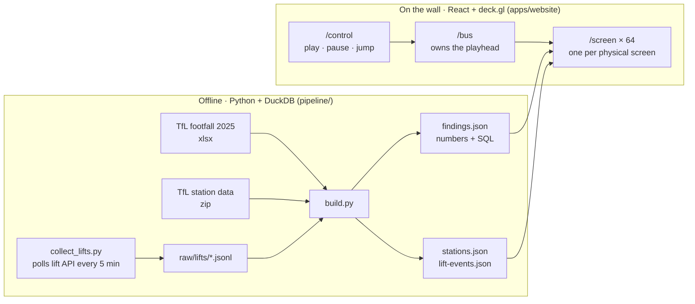

# The step-free gap

**Can you get into the Tube if you can't take the stairs?**

A data story for Imperial's [Data Observatory](https://www.imperial.ac.uk/data-science/facilities/data-observatory/) (DO), the 313° wall of 16 × 4 screens, built on Transport for London open data. It was made for the Data for Humanity Internship application (Developer Playground route).

> **40.5% of Tube and DLR journeys start at a station with no step-free route to any platform.**
> 160 of 300 stations in fare zones 1–6 have none. Of the 140 that do, 39 lose step-free access completely when a single lift fails.

---

## The story

Millions of journeys a day go through London's Tube. Wheelchair users, many older people and parents with buggies can only use the stations where they can get from the street to the platform without steps. The wall plays a 2-minute loop, read left to right:

| Time | Scene                     | What happens on the wall                                                                                                                                                                                 |
| ---- | ------------------------- | -------------------------------------------------------------------------------------------------------------------------------------------------------------------------------------------------------- |
| 0:00 | **The network**           | Every station is a neutral dot sized by annual journeys. It looks like an ordinary network map.                                                                                                          |
| 0:15 | **Where you can step in** | Dots split: teal = step-free to every platform, amber = some platforms, grey = none. The headline appears: 40.5% of journeys start where you can't step in.                                              |
| 0:45 | **Does it work?**         | One day of real lift outages (11 Nov 2026), recorded by my own collector, replays in 60 s. A failed lift gets a red ring on the map. If it was the only step-free route, the dot drops to amber or grey. |
| 1:45 | **One lift away**         | Stations where one broken lift removes all step-free access are outlined. Then the loop restarts.                                                                                                        |

### Wall layout

| Zone                   | Columns | Content                                                                                                                        |
| ---------------------- | ------- | ------------------------------------------------------------------------------------------------------------------------------ |
| A · the question       | 1–3     | "Can you get in?" and step-free stations out of the total                                                                      |
| B · where the gaps are | 4–11    | Dark map of inner London with the headline, the busiest station with no step-free access and its nearest step-free alternative |
| C · does it work?      | 12–14   | Lift-outage timeline, one row per station, replayed in sync with the map                                                       |
| D · so what            | 15–16   | Single-lift stations, closing line, sources, method and assumptions                                                            |

The main message sits in the centre of the room, and nothing critical sits on the seam where columns 1 and 16 meet behind the viewer. The design follows the DO guidance: dark backgrounds, slow fades rather than flashing, text sized relative to screen height so it reads from ~10 m, and an auto-playing loop because interaction may not be available on the wall.

## Key findings

All figures come from `apps/website/public/data/findings.json`, where each one is stored with the SQL query that produced it.

| Finding                                                                    | Value                                                                                        |
| -------------------------------------------------------------------------- | -------------------------------------------------------------------------------------------- |
| Stations in scope (Tube + DLR, zones 1–6)                                  | 300                                                                                          |
| Step-free to every platform / some platforms / none                        | 127 / 13 / 160                                                                               |
| Share of annual entries at stations with **no** step-free platform         | **40.5%** (491 million of 1.21 billion, 2025)                                                |
| Busiest station with no step-free access                                   | Oxford Circus, 24.5M entries a year; nearest fully step-free station Bond Street, 0.5 km     |
| Furthest from a step-free alternative                                      | Moor Park, 5.4 km to Pinner (straight line)                                                  |
| Step-free stations where one lift failing removes **all** step-free access | 39 of 140                                                                                    |
| Lift outages on the replayed day (11 Nov 2026, Tube/DLR)                   | 13 at 12 stations; 4 stations lost all step-free access; Canary Wharf's lift was out all day |

## How it is built



**Pipeline (`pipeline/`, Python + DuckDB).** It downloads the TfL files, matches stations across datasets, and computes everything the wall shows. The wall never calls TfL at runtime. The main steps:

- **Step-free routes by graph search.** TfL's detailed station data describes each station as areas joined by paths, ramps and lifts. A platform counts as step-free if it can be reached from the street without stairs or escalators.
- **Single-lift dependency.** Each lift is removed in turn and the search re-run. If no step-free platform is left, the station depends on that one lift.
- **Lift outages from my own data.** `collect_lifts.py` polled TfL's lift-disruption feed every 5 minutes from 3 Nov 2026. `lift_events.py` turns the polls into outage events, and it has unit tests. Missing polls count as _unknown_, never as _working_.

See [pipeline/README.md](pipeline/README.md) for the full method.

**Wall app (`apps/website/`).** It extends the [DO starter playground](https://github.com/dsi-icl/do-starter-playground) (React 19, TanStack Router, deck.gl + MapLibre):

- One shared camera: every `/screen` computes the same view and shifts it by its own tile offset, so the map lines up across all 64 screens without sending positions over the network.
- The `/bus` server owns the loop clock, so all screens show the same scene. If no bus is reachable, each screen falls back to the same timeline started on page load.
- `/preview` draws the whole 16 × 4 wall in a single canvas. 64 iframes would need 64 WebGL contexts, and browsers allow about 16.
- All loaded data is validated before use, and `findings.ts` is the only place that reads `findings.json`.

| File                                   | Role                                              |
| -------------------------------------- | ------------------------------------------------- |
| `src/lib/wall.ts`                      | Wall geometry (16 × 4 DO and 3 × 2 simulator)     |
| `src/lib/timeline.ts`                  | Scene list and loop timing                        |
| `src/lib/station-map.ts`               | Camera, dot sizes and colours                     |
| `src/components/wall-zones.tsx`        | Zones A–D, positioned in wall coordinates         |
| `src/routes/screen.tsx`, `preview.tsx` | One physical screen; the whole wall in one canvas |
| `src/routes/bus.ts`, `control.tsx`     | Playhead server; operator controls                |

## Run it

Needs Node ≥ 22.12 and pnpm.

```bash
pnpm install
pnpm dev                                   # dev server on http://localhost:5780
open http://localhost:5780/preview         # the whole wall, scaled to your screen
```

The processed data is committed, so the pipeline is optional. To rebuild it:

```bash
cd pipeline
python3 -m venv .venv && .venv/bin/pip install duckdb openpyxl
python3 fetch.py && .venv/bin/python build.py
python3 -m unittest test_lift_events
```

### Useful views

| URL                       | What you see                                                 |
| ------------------------- | ------------------------------------------------------------ |
| `/preview`                | The whole 16 × 4 wall in one canvas (about 1:18 on a laptop) |
| `/preview?cols=4-11`      | Zone B only, larger (any column range 1–16 works)            |
| `/preview?at=70`          | Frozen at 1:10, mid-replay (`at` = seconds into the loop)    |
| `/screen?wall=do&c=7&r=1` | One physical screen at life size (0-based column and row)    |
| `/`                       | The starter's 3 × 2 multi-screen simulator                   |
| `/control`                | Play / pause / jump to scene on every open page              |

## Data sources

| Data                              | Source                                                              | Period                |
| --------------------------------- | ------------------------------------------------------------------- | --------------------- |
| Annual station entries and exits  | TfL crowding data, `AC2025_AnnualisedEntryExit_public.xlsx` (v08.2) | typical 2025          |
| Stations, platforms, lifts, paths | TfL detailed station data, `tfl-stationdata-detailed.zip`           | published 20 Oct 2026 |
| Lift outages                      | TfL Unified API `Disruptions/Lifts/v2`, polled by me every 5 min    | 3–11 Nov 2026         |
| Basemap                           | CARTO Dark Matter, © OpenStreetMap contributors                     | —                     |

Powered by TfL Open Data.

## Limitations

- **Step-free means street to platform**, not platform to train. Steps and gaps onto the train are not included.
- **The headline is a lower bound.** Stations with step-free access to only some platforms count as step-free.
- **Journeys are entries, not people.** A person who taps in twice counts twice. DLR counts come from on-train passenger counters.
- **Distances are straight lines** and only consider Tube/DLR stations as alternatives, not buses or the Elizabeth line.
- **The replay is one day.** The 3–8 Nov collection ran on a laptop with large gaps (57 of 198 hours observed), so the replay uses 11 Nov, the longest stretch without gaps.
- **Different time frames are joined on station, never on date:** footfall from 2025, step-free routes as published in Oct 2026, outages from Nov 2026.
- The map frames inner London. About 40 outer stations are off its edges but still counted in every number.

## How AI was used

This project was built entirely with [Claude Code](https://claude.com/claude-code). I did not hand-write the code; I directed it, reviewed it and checked it.

**Setting the rules first.** Before any code, I wrote a brief for Claude Code (drafted with Claude's help) covering the question, the data sources, the wall's constraints and the deadline. It also set how we would work: plan before coding and wait for my approval, work in small steps and explain each change in plain words, ask before installing or deleting anything, never commit, and **never invent a number**. Any figure on the wall had to come out of the pipeline, with `[X]` placeholders until it did. If the brief turned out to be wrong once the real data was in, Claude was to say so rather than work around it quietly, and that happened more than once: the step-free data came from TfL's detailed station zip, not the API I had planned on, and the lift replay shrank from "a week" to the one gap-free day.

**What I decided.** The question and the story, the choice of datasets, collecting the lift-outage data myself over nine days, the scope (Tube + DLR, zones 1–6), what counts as "step-free", treating gaps in the feed as unknown, and the design choices on the wall (inner-London framing, colours, text sizes, the 2-minute loop). Claude Code proposed options and implemented them; I chose between them.

**What Claude Code did.** It read the starter repo and explained its architecture back to me, inspected the raw data, and wrote the Python/DuckDB pipeline, its unit tests, the wall app changes (`/preview`, the shared playhead, zones A–D, the lift replay) and drafts of this README.

**How I checked it.** Every number on the wall is stored in `findings.json` next to the SQL that produced it, so each one can be traced and re-run. The outage logic has unit tests. I went through each change in `/preview` and the simulator before accepting it, and I asked for explanations until I could explain every part of the code myself.

## Credits

Built on the [Data Observatory starter playground](https://github.com/dsi-icl/do-starter-playground) by Imperial's Data Science Institute. The starter's original README is kept in [README.starter.md](README.starter.md).
